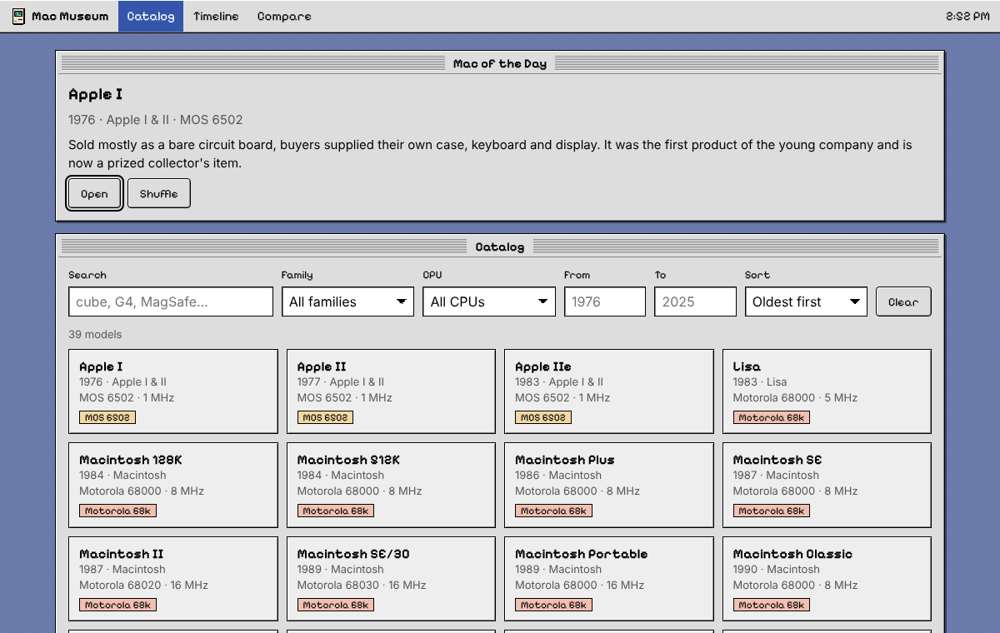
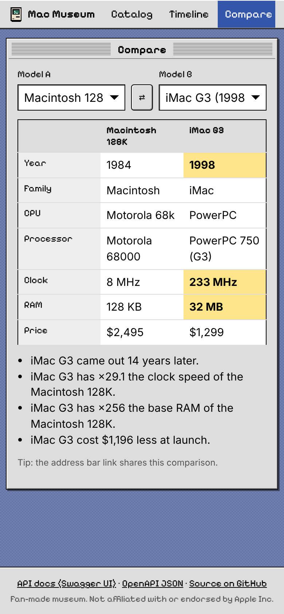
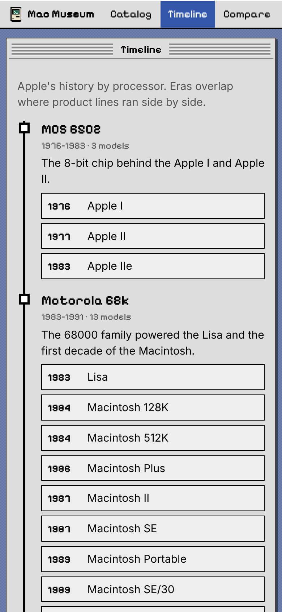
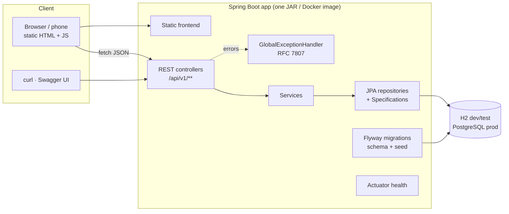

# Mac Museum API

*made this project on the subway to uni with claude lol*

[](https://github.com/rsinghSD/mac-museum-api/actions/workflows/ci.yml)


[](LICENSE)

> A REST API and retro web catalog of Apple hardware history, from the Apple I (1976) to Apple silicon. Like a Pokédex, but for Macs.

**Live demo:** _coming soon_ · [Deploy your own on Render](docs/deployment.md)



<p align="center">
  
  
</p>

## Features

- **Catalog:** 39 curated models in 16 product families. Prices or specs we are not sure of are left empty rather than guessed.
- **Search & filters:** filter by exact year, year range, family, CPU architecture and free text. Results are paginated and sortable.
- **Timeline:** the whole history grouped into CPU eras: 6502 → 68k → ARM → PowerPC → Intel → Apple silicon.
- **Compare:** 2–4 models side by side, with clock and RAM multiples and price difference.
- **Mac of the day:** a random model, stable for everyone on the same date.
- **Curator CRUD:** create, replace, rename and delete models, with Bean Validation.
- **Consistent errors:** every error is an [RFC 7807](https://www.rfc-editor.org/rfc/rfc7807) problem detail, with field errors for invalid input.
- **Retro UI:** a mobile-first web app inspired by the 1990s "Platinum" desktop. Plain HTML/CSS/JS, served by the same JAR.
- **Ops-ready:** Swagger UI, Actuator health probes, a Docker image with a health check, docker-compose with PostgreSQL, and a Render Blueprint.

## Tech stack

| Tech | Why |
|------|-----|
| **Java 21** | Current LTS. Records keep DTOs to a few lines; sequenced collections and `RandomGenerator` are used where they fit. |
| **Spring Boot 3.5** | The standard for Java backends. Auto-configuration lets the code focus on the domain ([ADR 0001](docs/adr/0001-use-spring-boot.md)). |
| **Spring Data JPA** | Repositories remove boilerplate, and the `Specification` API builds the optional filters without string-concatenated SQL. |
| **Flyway** | Versioned, reviewable SQL migrations. The seed data is a migration too, so every environment starts identical ([ADR 0002](docs/adr/0002-use-flyway-for-migrations.md)). |
| **H2 / PostgreSQL** | H2 means zero setup for development and tests. PostgreSQL is a robust, free production database, and Testcontainers runs the same tests against it in CI. |
| **Bean Validation** | Declarative input rules on request records, turned into 400 problem details in one place. |
| **springdoc-openapi** | API docs generated from the code, so they cannot drift. A test fails if an endpoint is missing. |
| **JUnit 5, Mockito, MockMvc, Testcontainers, JaCoCo** | Fast unit tests for the logic, HTTP-level tests for every endpoint and a real-PostgreSQL test. The build fails below 80% line coverage. |
| **Vanilla HTML/CSS/JS** | No second toolchain or build step: one JAR serves API and UI ([ADR 0003](docs/adr/0003-static-frontend-instead-of-react.md)). |
| **Docker & Compose** | Reproducible runtime: a multi-stage, layered, non-root image, plus a one-command local stack. |
| **GitHub Actions** | Runs `mvn verify` and builds and smoke-tests the Docker image on every push and pull request. |
| **Render** | Free hosting for a Docker service and PostgreSQL, described as code in `render.yaml`. |

## Architecture



Code is organised by feature (`model`, `family`, `timeline`, `compare`,
`common`). Controllers stay thin, services hold the rules, and entities never
leave the service layer. More in [docs/architecture.md](docs/architecture.md).

## API

Base path `/api/v1`. Interactive docs at **`/swagger-ui.html`**, OpenAPI JSON at `/v3/api-docs`.

| Method | Path | Description |
|--------|------|-------------|
| GET | `/models` | Paginated list. Filters: `year`, `fromYear`, `toYear`, `family`, `cpu`, `q`; plus `page`, `size` (max 100), `sort` |
| GET | `/models/{slug}` | One model |
| POST | `/models` | Create (201 + `Location`) |
| PUT | `/models/{slug}` | Replace (the slug in the body can rename it) |
| DELETE | `/models/{slug}` | Delete (204) |
| GET | `/families` | Product families with model counts |
| GET | `/timeline` | Models grouped by CPU era, oldest first |
| GET | `/compare?slugs=a,b` | 2–4 models side by side, compared with the first |
| GET | `/random` | Random model; `?day=2026-11-11` gives a stable "Mac of the day" |

CPU values: `MOS_6502`, `M68K`, `ARM`, `POWERPC`, `INTEL_X86`, `APPLE_SILICON` (case-insensitive; `apple-silicon` works too).

### Examples

```bash
# Browse and filter
curl "http://localhost:8080/api/v1/models?size=5&sort=releaseYear,desc"
curl "http://localhost:8080/api/v1/models?family=powerbook&cpu=powerpc"
curl "http://localhost:8080/api/v1/models?fromYear=1998&toYear=2002&q=g4"
curl http://localhost:8080/api/v1/models/macintosh-128k
curl http://localhost:8080/api/v1/families

# Discover
curl http://localhost:8080/api/v1/timeline
curl "http://localhost:8080/api/v1/compare?slugs=macintosh-128k,macbook-air-m1"
curl "http://localhost:8080/api/v1/random?day=2026-11-11"

# Curate
curl -i -X POST http://localhost:8080/api/v1/models -H 'Content-Type: application/json' -d '{
  "slug": "power-mac-g4-mdd", "name": "Power Mac G4 (Mirrored Drive Doors)",
  "releaseYear": 2002, "familySlug": "power-macintosh", "cpuArchitecture": "POWERPC",
  "cpuName": "PowerPC G4", "clockSpeedMhz": 867, "baseRamKb": 262144,
  "summary": "A dual-processor tower nicknamed for its two drive bays."}'
curl -i -X DELETE http://localhost:8080/api/v1/models/power-mac-g4-mdd
```

A model:
```json
{"slug":"macintosh-128k","name":"Macintosh 128K","releaseYear":1984,"launchPriceUsd":2495.00,
 "family":{"slug":"macintosh","name":"Macintosh"},"cpuArchitecture":"M68K","cpuName":"Motorola 68000",
 "clockSpeedMhz":8,"baseRamKb":128,"summary":"The original Macintosh brought the mouse-driven ..."}
```

A comparison (Macintosh 128K vs MacBook Air M1):
```json
{"baselineSlug":"macintosh-128k","otherSlug":"macbook-air-m1","yearsApart":36,
 "clockSpeedRatio":400.0,"ramRatio":65536.0,"priceDifferenceUsd":-1496.00}
```

Errors are problem details:
```json
{"type":"about:blank","title":"Resource not found","status":404,
 "detail":"No model found with slug 'nope'","instance":"/api/v1/models/nope"}
```
```json
{"title":"Invalid parameter","status":400,
 "detail":"Invalid value 'z80' for parameter 'cpu'. Allowed values: MOS_6502, M68K, ARM, POWERPC, INTEL_X86, APPLE_SILICON"}
```
Validation failures add an `errors` object mapping each field to its message.

## Run locally

**With Maven** (Java 21; uses in-memory H2, nothing else to install):
```bash
./mvnw spring-boot:run        # http://localhost:8080
./mvnw verify                 # all tests + coverage gate (PostgreSQL test runs if Docker is available)
```

**With Docker** (app + PostgreSQL, prod profile):
```bash
docker compose up --build     # http://localhost:8080
docker compose down -v        # stop and delete the database volume
```
Optional: copy `.env.example` to `.env` to change credentials or the port.

## Deploy

One click with the included Render Blueprint: **New → Blueprint →** this repository.
Step-by-step guide, environment variables and free-tier caveats: [docs/deployment.md](docs/deployment.md).

## Project structure

```
mac-museum-api/
├── src/main/java/io/github/rsinghsd/macmuseum/
│   ├── model/          AppleModel: entity, repository, filters, service, controllers, DTOs
│   ├── family/         ProductFamily: entity, repository, service, controller
│   ├── timeline/       CPU-era grouping (/timeline)
│   ├── compare/        side-by-side comparison (/compare)
│   └── common/         errors (ProblemDetail), paging, OpenAPI, web config
├── src/main/resources/
│   ├── db/migration/   Flyway: V1 schema, V2 families, V3 models
│   ├── static/         retro frontend (index.html, css/, js/, img/)
│   ├── application.yml       defaults (H2)
│   └── application-prod.yml  PostgreSQL via environment variables
├── src/test/java/…     *Test (unit) and *IT (MockMvc / Testcontainers)
├── docs/               architecture, ADRs, user stories, deployment, screenshots
├── scripts/            setup-github.sh (labels, milestones, issues)
├── Dockerfile · docker-compose.yml · render.yaml
└── .github/            CI workflow, issue and PR templates
```

## Documentation

- [Architecture](docs/architecture.md) · [Decision records](docs/adr/) · [User stories](docs/user-stories.md)
- [Deployment](docs/deployment.md) · [Contributing](CONTRIBUTING.md) · [Project conventions](CLAUDE.md)

## Roadmap

- [x] **v0.1** Project setup, CI, docs, user stories
- [x] **v0.2** Domain, migrations, seed data, CRUD API with tests
- [x] **v0.3** Filters, timeline, compare, random, Swagger, error handling
- [x] **v0.4** Retro Platinum web frontend
- [x] **v0.5** Docker, prod profile, PostgreSQL integration test
- [ ] **v1.0** Live on Render
- [ ] **Next:** API-key protection for write endpoints · source citations per model · more models (Apple IIGS, Power Mac G4 MDD, Mac Studio…) · image gallery with freely licensed photos · ETag caching

## License

[MIT](LICENSE). Not affiliated with or endorsed by Apple Inc. Apple, Macintosh, iMac, iPod, iPhone and iPad are trademarks of Apple Inc., used here only to identify historical products. All descriptions are original, and the UI uses no Apple artwork.
