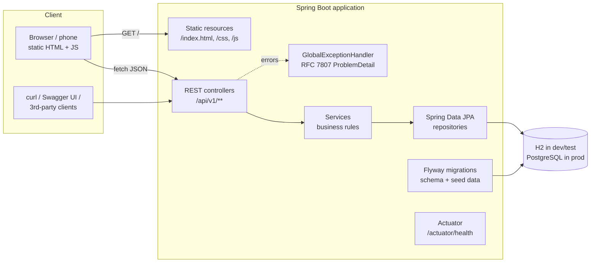
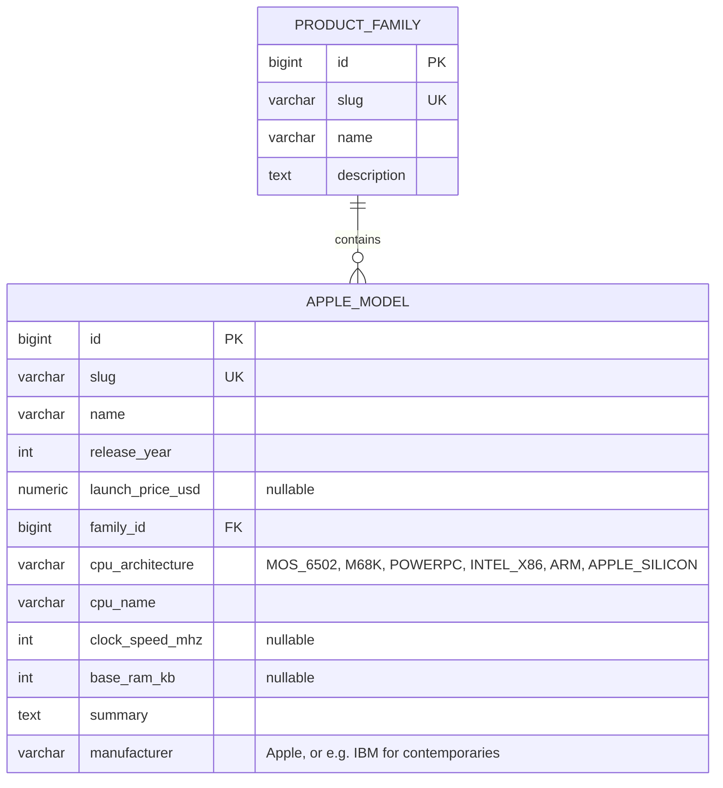
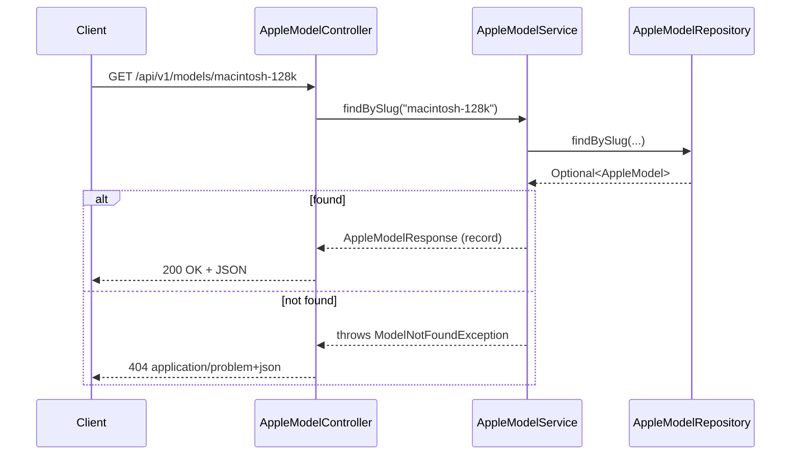
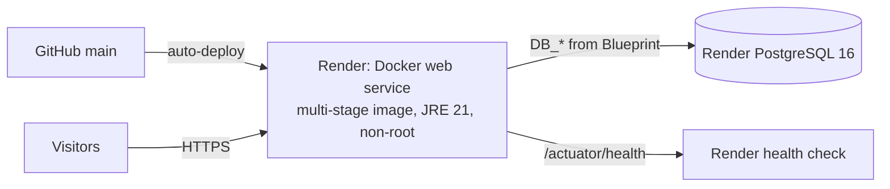

# Architecture

Mac Museum API is a single deployable Spring Boot application that serves both
a JSON REST API and a static web frontend.

## Overview

## Layers

| Layer | Responsibility | Rules |
|-------|----------------|-------|
| Controller | HTTP mapping, input validation, DTO in/out | No business logic, no entities in signatures |
| Service | Business rules, transactions, mapping entity ↔ DTO | Throws domain exceptions |
| Repository | Persistence via Spring Data JPA | Queries/specifications only |
| Entity | JPA mapping of the schema | Never leaves the service layer |

## Domain model

## Request flow (example: `GET /api/v1/models/macintosh-128k`)

## Profiles

| Profile | Database | Use |
|---------|----------|-----|
| default | H2 in-memory | local development, tests |
| `prod`  | PostgreSQL (`DB_HOST`, `DB_PORT`, `DB_NAME`, `DB_USER`, `DB_PASSWORD`) | Docker / Render deployment |

## Deployment

CI (`.github/workflows/ci.yml`) runs `mvn verify`, including a Testcontainers
PostgreSQL test, and in a second job builds the Docker image, starts it against
PostgreSQL and smoke-tests it. See [deployment.md](deployment.md).

Flyway runs the same migrations against both databases, so the SQL is kept
portable (ANSI types, no vendor-specific functions). `PostgresProfileIT`
proves it on real PostgreSQL.

## Cross-cutting concerns
- **Errors**: one `@RestControllerAdvice` maps exceptions to `ProblemDetail`.
- **Write protection**: `WriteApiKeyInterceptor` requires `X-API-Key` on write
  methods when `WRITE_API_KEY` is set; in `prod` without a key, writes get 403.
- **Docs**: springdoc generates OpenAPI 3 at `/v3/api-docs`, UI at `/swagger-ui.html`.
- **Health**: Actuator `/actuator/health` used by Docker and Render health checks.
- **Coverage**: JaCoCo report and threshold check during `mvn verify`.

See [`adr/`](adr/) for the reasoning behind key decisions.
